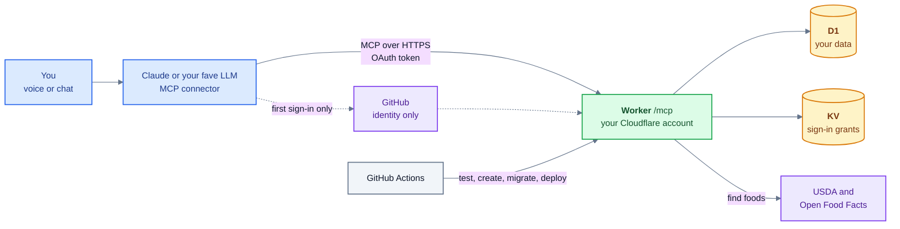

# Architecture

Who talks to whom. Everything in the green box runs in your own Cloudflare account; GitHub Actions only deploys and never serves requests.

The assistant decides which tool to call. The server knows who you are from the sign-in token, does all the logic and nutrition math, and reads and writes your data. See [one tool call](tool-call.md) for what happens inside the Worker.

Colors: see the [legend](README.md#colors).
