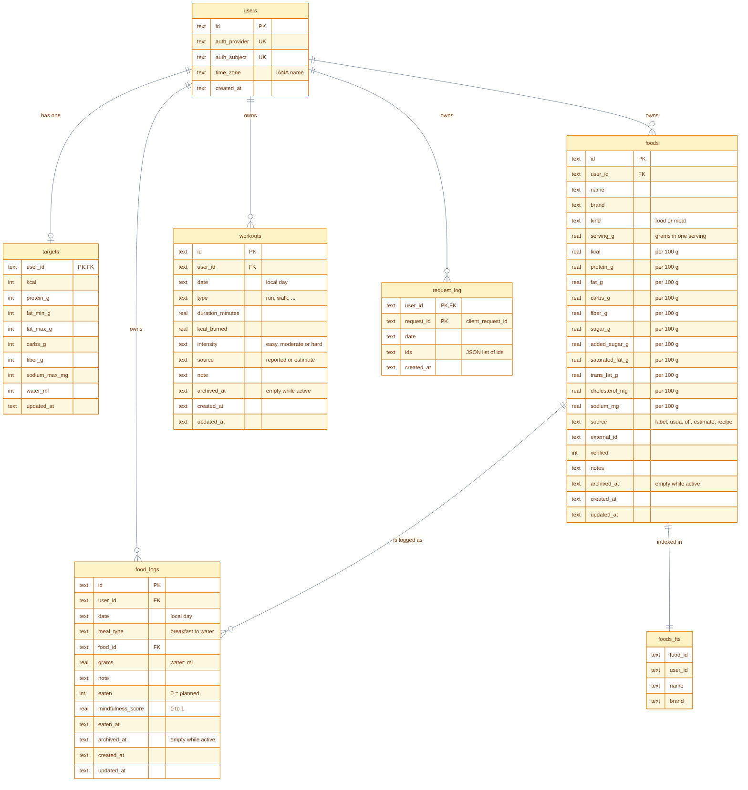

# Data model: all fields

`PK` primary key, `FK` foreign key, `UK` unique. Dates are the user's local day (`YYYY-MM-DD`); timestamps are UTC ISO 8601 text. `archived_at` is empty while the row is active.

Values worth knowing:
- `foods.source`: label, usda, off, estimate or recipe. A food with even one estimated nutrient has source `estimate`. A saved meal is a food with `kind` `meal`, and its `serving_g` is the whole meal's weight. A meal made from saved foods lists its ingredients in `notes`.
- `food_logs.meal_type`: breakfast, lunch, dinner, snack, dessert or water (for water, grams are millilitres).
- `food_logs.mindfulness_score`: stored as 0 to 1, shown as 1 to 10.
- `workouts.type`: run, walk, cycle, swim, strength, yoga, hiit or other.
- `workouts.source`: reported when the user gave the calories burned and intensity, estimate when Claude estimated either one.

See also [data model: overview](data-model-overview.md).

Colors: see the [legend](README.md#colors).
