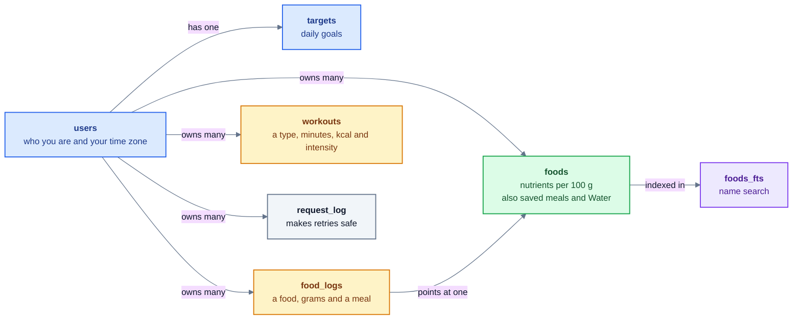

# Data model: overview

Every row belongs to one user. A log only points at a food and holds an amount in grams; the nutrients live on `foods` and the server calculates them. Nothing is deleted through the tools: logs, workouts and foods are archived.

All the fields are in [data model: all fields](data-model-fields.md). The schema itself is [`migrations/0001_schema.sql`](../../migrations/0001_schema.sql).

Colors: see the [legend](README.md#colors).
