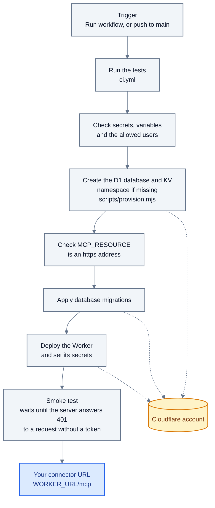

# Deploy

What the Deploy workflow does when you click Run workflow, or on a push to `main` once the repository variable `DEPLOY_ENABLED` is `true`. Nothing is ever deployed from a laptop.

A failed check stops the run before anything changes. Only one deploy runs at a time.

Colors: see the [legend](README.md#colors).
