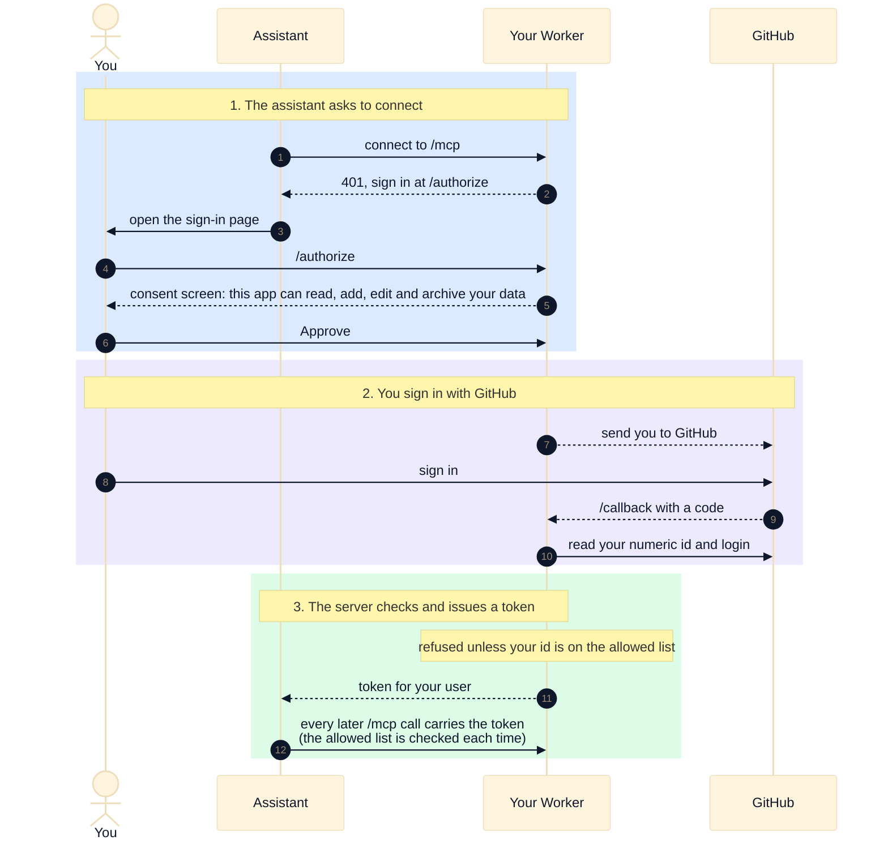

# Sign-in

The first time an assistant connects, you sign in with GitHub. Only GitHub ids listed in `config/allowed-users.json` get through, and that list is checked again on every request.

The token is bound to your server's address and to your user, so it cannot be used anywhere else. Your GitHub access token is not kept.

Colors: see the [legend](README.md#colors).
