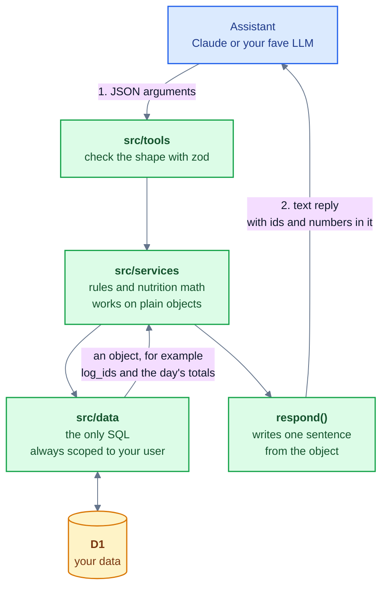

# One tool call

What happens inside the Worker when the assistant calls a tool. The assistant sends JSON arguments; the server keeps the data as plain objects all the way through and writes the reply sentence only at the very end.

The user is never an input: it comes from the sign-in token. The assistant reads the text reply, so every id and number it needs must be in that text.

Colors: see the [legend](README.md#colors).
